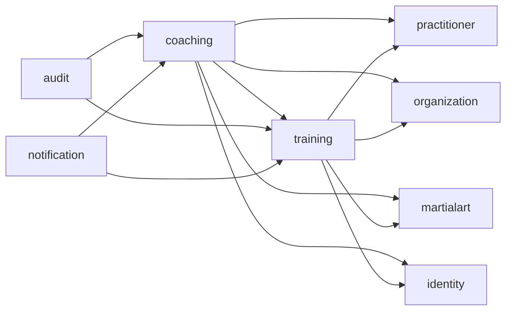

# Architecture

## Decision and dependencies

HAJIME is one deployable modular monolith and one PostgreSQL database. Feature modules own their tables. Package roots expose contracts; `api`, `application`, `domain`, and `infrastructure` packages remain module internals. `ApplicationModules.verify()` enforces both encapsulation and explicit allowed dependencies. JPA relationships never point to another module's entity; UUID foreign keys preserve relational integrity.

The small `shared` kernel contains provenance, transport-neutral identifiers via UUID, application error definitions, bounded pagination, and web configuration. Modules depend on it explicitly. It owns no product tables.

Training separates an immutable, typed state-transition aggregate from its persistence adapter and HTTP views. TrainingContent owns nested-entry invariants and immutable collections; recording factories set initial state/provenance, while restore preserves historical data. Coaching uses immutable domain records and explicit SQL repositories: adding a second entity model without domain behavior would add mapping ceremony. JDBC and JPA participate in the same Spring-managed PostgreSQL transaction. Domain values protect text, ranges, collections and creation-time rules even outside HTTP. A UTC Clock is injected into training/coaching operations. Controllers validate and delegate; application services enforce ownership, organization scope, and business rules.

## Transactional slice

1. Athlete creates a PERSONAL/RECORDED journal. Repeating a supplied UUID with the same owner, scope and recorded content returns the current persisted session (HTTP 201 and the same Location); changed content or another owner receives TRAINING_ID_CONFLICT without exposing data. Technique order is immaterial, sparring order is preserved, and occurrence timestamps use PostgreSQL microsecond precision. PostgreSQL transaction advisory locks serialize same-ID creation across API instances; hash collisions only serialize unrelated IDs. Requests without an ID get a new ID and are not deduplicated. The profile must be theirs, techniques must belong to its active martial art, and any organization must support that art and include the athlete.
2. Share requires the expected version and RECORDED state. The athlete must still be a member with an active practitioner profile. Inactive profiles can read historical records but cannot share. The aggregate becomes SHARED_WITH_COACH.
3. A synchronous TrainingSessionShared listener creates an organization-scoped pending review. Audit and outbox listeners write rows in the same transaction.
4. A coach with REVIEW_TRAINING loads only that organization's review. Version comparison plus an atomic conditional SQL update prevents two coaches completing it.
5. Feedback, training REVIEWED transition, optional goal, audit, and outbox writes commit together. Invalid goal input rolls all of them back. GoalAssignment is reused by feedback and standalone assignment under a mandatory existing transaction. A dedicated sharing listener creates reviews. Goal assignment separately requires ASSIGN_GOAL and an active membership for the target athlete in that organization.
6. Athlete feedback and goal queries are constrained by their own profile IDs. Coach requests always carry organization ID into repository predicates.

There is no asynchronous cross-module work on the critical path, so rollback remains local and observable. In-process events are not a durable notification transport; the outbox supplies durability for future external delivery.

## Authentication and authorization

`CurrentUser` isolates application code from Spring Security and JWT validation. `dev`/`test` SecurityFilterChain builds a local adapter with three fixed aliases. No adapter bean is globally registered. Any other profile has a stateless protected filter chain; a dev header cannot authenticate there (tested). Error responses use ProblemDetail, including authentication failures.

Authentication is local and needs no cloud provider. `POST /api/v1/auth/register` creates a local account;
`login` verifies PBKDF2-HMAC-SHA256 hashes (600,000 iterations, random salt, versioned encoding).
Access tokens are HS256 JWTs with issuer, audience, expiration, subject and session ID. Outside dev/test,
`HAJIME_JWT_SECRET` must supply at least 32 random bytes encoded as Base64; no key is hardcoded.
Dev/test can use an ephemeral random key, invalidating previous access JWTs on restart.
The decoder verifies signature/standard claims and the active database session, so logout, account
disabling and replay revocation reject access immediately. Subject resolution still uses `CurrentUser`.

Refresh tokens contain 32 random bytes and are stored only as SHA-256 digests. Refresh locks its session,
consumes the old token and issues a replacement atomically. Reusing a consumed token revokes that session
family; the revocation commits even though the caller receives 401. Other sessions remain independent.
Clients must serialize refresh requests. Sessions have an absolute 30-day lifetime; access tokens default
to 15 minutes and cannot outlive that session. Bounded hourly cleanup deletes families expired more than
a day ago and cascades refresh history. Live families retain consumed hashes for replay detection.

PostgreSQL rate limits bound auth requests by direct peer address and login attempts by normalized account,
without Redis. Defaults are 100/IP and 10/account per 15 minutes, counting attempts irrespective of success.
Proxy deployments need deliberate trusted-forwarding/ingress configuration; arbitrary X-Forwarded-For is
not trusted. Auth responses disable caching. Password changes and one-time offline recovery codes are implemented; email verification and MFA are deferred.
Open registration grants no dojo membership, coach role or official rank. These endpoints are suitable
for the current pilot scope, not a claim that public signup lifecycle/operations are finished.

In dev/test the existing fixed-alias adapter remains available for the legacy walkthrough. Explicit
Authorization always uses JWT and never falls back to a dev identity; auth endpoints skip impersonation.
Combining prod/production with dev/test fails startup. Production ignores X-Dev-User. No form login,
Basic authentication or HTTP session is enabled. TLS/ingress and mobile secure token storage are deployment
and client responsibilities. See [local authentication](local-authentication.md) and ADR-012.

Roles and permission sets are intentionally small and static. Membership scope, not a JWT global role, decides dojo permissions. Revoking a membership immediately affects new use cases because the database is consulted each time. No dynamic authorization engine is needed.

## Policies and configuration

`MartialArtPolicy` bundles five cohesive contracts, resolved through a registry keyed by the extensible `MartialArtCode` value object (not a closed enum). Judo policy objects live only in `martialart.domain.judo`. Ranking selects the next configured order within the same rank system; it never names belt colors. Curriculum checks criteria sets; evaluation requires both passed criteria and evaluator authority. Competition currently recognizes prototype score labels only, and terminology maps neutral concepts to display terms. These are foundations for future grading/competition modules, not federation-certified rule engines. Any rulebook/age/category-specific rules must be versioned before those modules ship.

The catalog migration is safe configuration seed for all environments. Demo identities and organizations exist only under the separate dev Flyway location. See ADR-008 for migration versioning constraints.

## Outbox and observability

Important events write `outbox_event` atomically with the action. The opt-in processor claims one
row at a time using `FOR UPDATE SKIP LOCKED` in a short committed transaction. A random claim token
and expiration fence acknowledgments from stale workers. Delivery runs outside the database transaction,
with a configurable deadline and bounded in-flight calls. Timed-out providers keep their capacity slot
until they actually exit; ignored interruption cannot create unlimited workers. Providers must still set
I/O timeouts and deduplicate event UUIDs because cancellation cannot undo an accepted external side effect.
Failures retry with capped exponential backoff; exhausted events, including crashes on the last attempt,
are parked as dead letters. Database acknowledgment errors propagate and leave the lease recoverable,
instead of being mislabeled as provider failures. Success/failure metrics increment after committed updates.

The free local sink persists one deduplicated `local_notification_receipt` per event and logs identifiers
only. It is not push delivery. Production does not consume events by default. Internal operator methods
support explicit dead-letter requeue and bounded retention of processed rows; neither has a public HTTP
endpoint. Receipt deduplication history survives outbox cleanup. A real external provider and its operational
integration remain future work. See [outbox operations](outbox-operations.md) and ADR-011.

Actuator exposes only safe health/info locally; production permits anonymous health only. Micrometer tracks successful and failed outbox deliveries. No monitoring services are deployed. Audit records contain identifiers, action, actor, organization, and minimal JSON metadata; journal and feedback text are excluded.

## Persistence and operational limits

UUID primary keys, timestamptz, UTC JDBC behavior, Flyway migrations, normal relational columns, sparse JSONB, indexes on ownership and pending queues. JPA open-in-view is disabled and Hibernate validates the schema. Bounded pagination limits requests to 100 rows; collection batching avoids per-row history collection fetching. Sort input is allowlisted rather than interpolated into SQL. Technique validation is batched, and commands resolve the actor once. V8 adds composite foreign keys tying training/review/feedback/goal scopes together and rejects blank goal text. Existing inconsistent data must be corrected explicitly before applying V8; previous migrations are unchanged. Database foreign keys can cross ownership boundaries; module code cannot.

This is an initial runnable foundation. Membership/rank administration, OIDC onboarding, API rate limiting, production secrets/backup automation, cloud infrastructure, and offline reconciliation are deliberately not product flows in this release.

## Transport-independent business errors

`BusinessException` carries a semantic category, stable code and safe message, without HTTP status numbers.
`shared.web.ApiErrors` alone maps categories to 400/401/403/404/409/422 ProblemDetail responses. Existing public
error codes/statuses are preserved. An architecture test prevents domain/application code from depending
on HTTP/Servlet types. Unexpected failures remain generic 500 responses with server-side diagnostics.
