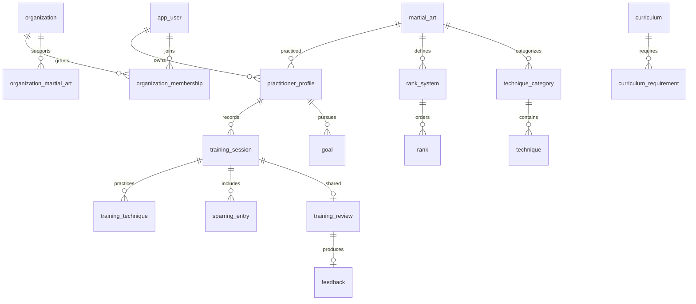

# Domain model

| Owner | Tables / concepts | Invariants |
| --- | --- | --- |
| identity | app_user, local_credential, auth_session, refresh_token, auth_rate_limit | Unique normalized email, hashed credentials, rotated refresh digests, session revocation |
| organization | organization, organization_martial_art, organization_membership | Roles are scoped to org/user; organization supports many arts |
| martialart | martial_art, rank_system, rank, technique_category, technique | Catalog codes unique in scope; rank order comes from data |
| curriculum | curriculum, curriculum_requirement | Versioned requirements, optional org override, optional technique |
| practitioner | practitioner_profile | One profile per user/art in this prototype; rank and weight belong to profile |
| training | training_session, training_technique, sparring_entry | Athlete ownership, matching art, explicit transitions and optimistic version |
| coaching | training_review, feedback, goal | Review belongs to organization; one initial feedback per review; goal targets member |
| audit | audit_log | Append-only application writes in action transaction |
| notification | outbox_event, local_notification_receipt | Leased delivery, bounded retries/dead letters and durable local deduplication |

TrainingSession is the journal aggregate; technique and sparring values belong to it. State transitions: DRAFT is reserved, creation records RECORDED, share changes RECORDED → SHARED_WITH_COACH, and accepted feedback changes SHARED_WITH_COACH → REVIEWED. No generic state-machine engine is used. Immutable domain snapshots retain the persistence version. A client must submit `version` for share/review, and the database also checks concurrent updates.

Practice types are TECHNICAL, SPARRING, CONDITIONING, MIXED. Duration is 1–720 minutes; perceived intensity 1–10; energy 1–5. Technique entries permit repetitions/duration/notes; sparring entries permit rounds/intensity/notes. The domain always uses Sparring, while Judo displays Randori.

Goal holds practitioner, organization, martial art, assigning coach, optional source session and technique, title, objective, observation, priority, review date, timestamps, status, provenance, and version. Statuses are ACTIVE, ACHIEVED, CANCELLED; priorities LOW, NORMAL, HIGH. This release creates and reads goals only. Future lifecycle/evidence APIs must use real related training evidence, never inferred completion percentages.

RecordSource is PERSONAL, ORGANIZATION, OFFICIAL. Provenance describes who entered/validated a record, not its current visibility. A reviewed personal journal remains PERSONAL; the coach's goal is ORGANIZATION. Future conflict resolution must honor source authority. IDs are UUIDs, and personal training accepts a client-generated ID to support future offline work; repeating the same owner/content/ID recovers the existing record; changed content conflicts rather than overwriting.

Prototype Judo ranks are 6th Kyu/White through 1st Kyu/Brown, then 1st Dan/Black. These values describe the prototype adult rank system, not every federation, country, or age group. Curricula and competition policy are explicitly provisional. Store future authoritative versions as data/configuration and cohesive policy variants.

Attendance will represent classes and attendance corrections with provenance and audit. Grading will connect Evaluation and EvaluationCriterion to a curriculum snapshot, then PromotionProposal and approved Promotion. Competition will represent CompetitionEvent, Match, MatchParticipant, and MatchResult with discipline scoring details behind policies. Their contracts are present; no workflow or endpoints are implemented yet.
